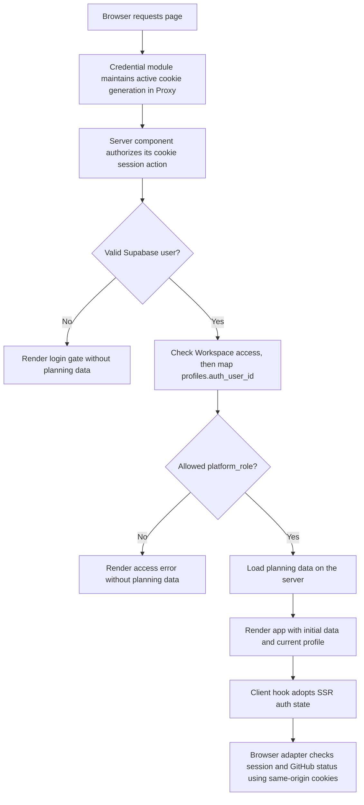
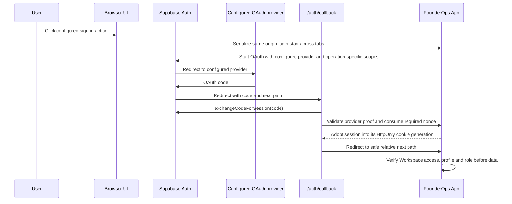
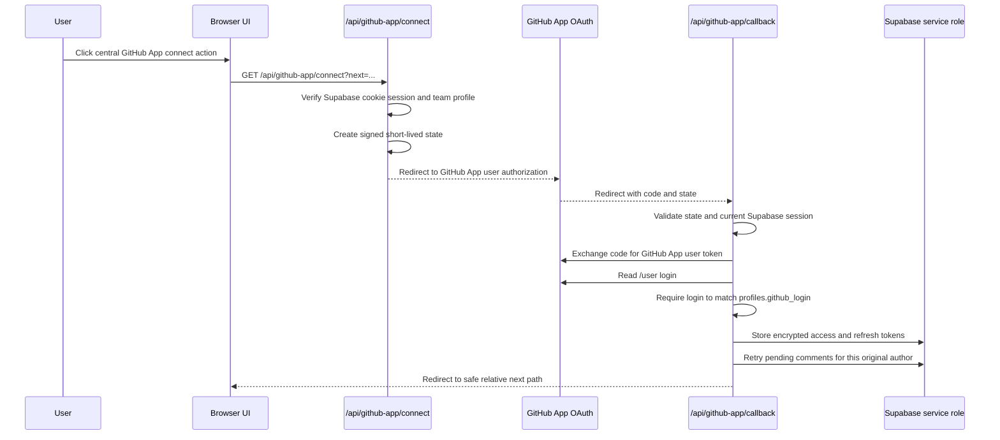
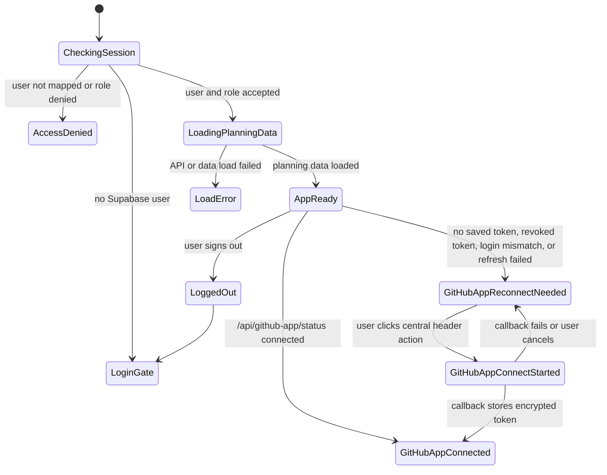
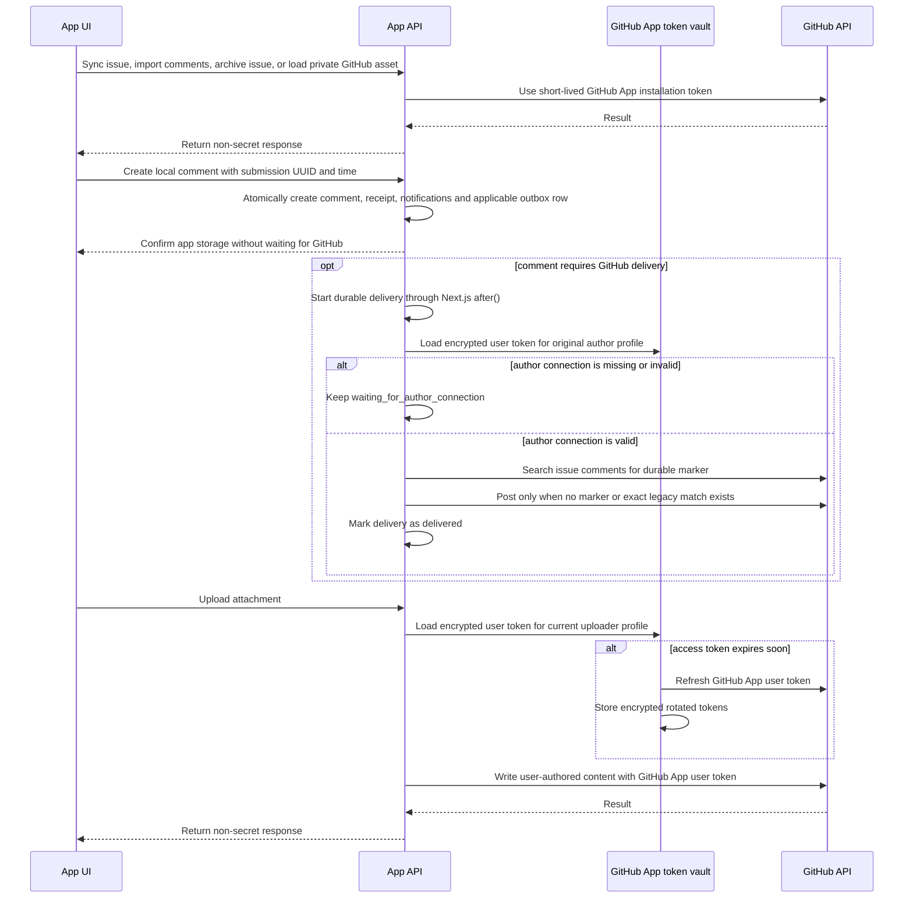

# Authentication flow

This document owns the FounderOps web session lifecycle, browser transport and reconnect states. [Credential verification](credential-verification.md) owns action authorization, provider rotation, evidence deadlines and data permits.

The staged Google migration and its operational prerequisites are specified in [Google Workspace access](google-workspace-access.md). The private database mode controls the login provider. GitHub sign-in remains available only during the legacy/linking stages; after cutover it is an integration only.

## Principles

- Supabase owns the user session. The credential module manages its server-owned HttpOnly cookie transport and SDK refresh.
- The verified Auth user maps through `profiles.auth_user_id`; `profiles.platform_role` authorizes the application action.
- Planning data is never rendered or serialized in strict auth mode until the request has a verified Supabase user and a mapped profile role.
- GitHub issue sync, dependencies, GitHub comment import, private asset proxying, and issue archival use server-side GitHub App installation tokens.
- User-authored GitHub comments and attachments use the original author's encrypted server-side GitHub App user token with refresh rotation.
- Every valid mapped team session, including viewers, may trigger issue sync. Task mutations and comment creation keep their stricter role rules.
- Issue projection status and comment delivery status are independent. A missing author connection never turns a successful issue sync into a failure.
- GitHub App user tokens are never exposed to the browser, logs, GitHub issues, API responses, or documentation.
- GitHub reconnect UI is centralized in the header/notification area. GitHub-dependent cards may show disabled actions, but they must not repeat their own reconnect button or start OAuth automatically.

## Page entry

## Supabase application login

Supabase owns application login and session restoration. Google is the final application provider. GitHub login remains only for the controlled migration stages. Neither provider session supplies GitHub API credentials.

## GitHub App author connection

## Runtime UI states

## GitHub API credentials

## Scenario expectations

- Page reload with a valid session: the server verifies the cookie session, loads planning data, and the client checks `/api/github-app/status`. It must not flash the login gate.
- Browser closed and reopened: Supabase cookies restore the app session when still valid; the saved encrypted GitHub App user token keeps GitHub comments and attachments usable without another manual reconnect.
- Laptop standby then resume: Proxy maintenance and browser recovery request server-owned session renewal. `/api/github-app/status` refreshes a soon-expiring GitHub App user access token when possible.
- Missing, revoked, expired, or mismatched GitHub App user connection: issue sync remains available. A locally saved comment waits for its original author's connection and is retried after OAuth reconnect or a later task/bulk sync. It must not start OAuth only because a task was opened.
- Same-tab reload with an unfinished submitted comment: restore its account-scoped `sessionStorage` capture, then use the authorized submission receipt lookup before exposing recovered text. Lookup confirms the original stored comment without another POST. Unsent drafts remain in memory across item/tab changes and do not survive reload.
- Expired or revoked Supabase session: the app clears protected client state, including comment drafts and submitted recovery capture, and returns to the login gate. Logout, account replacement and protected-state reset also clear this state. Late results cannot restore it for a different session or account.

## Cookie generations and browser coordination

The browser imports `createBrowserSessionAdapter` from `@/lib/credentials/browser`. It receives safe identity, expiry and an opaque credential revision, never an access/refresh token. Requests use same-origin cookies; the adapter has no Auth SDK, token introspection or independent provider refresh. Explicit Bearer callers retain their supplied Authorization. Its presence takes precedence over cookies, including malformed credentials.

Each replacement login creates a random cookie generation. Refresh and callback responses write only their own generation and never replace the active-generation pointer. Logout revokes that generation so delayed Set-Cookie cannot restore it. Pointerless legacy cookies use a fixed compatibility generation and cannot overwrite a newer login pointer. Canonical SDK cookies are adopted into scoped HttpOnly storage and removed; browser code does not maintain a second mirror.

Proxy constructs its response after awaited renewal and forwards updated cookies to both the downstream request and browser response. SSR authorizes before loading protected data and retains the verification start preceding cookie-session work.

Explicit login starts use a cross-tab Web Lock through the actual same-origin POST response and cookie application, then navigate to the server-selected provider. Unsupported locking fails visibly without starting login. The adapter coalesces equivalent reads/recovery, rejects obsolete responses and coordinates account changes across tabs. Logout clears protected subscribers/data before navigation; delayed protected bodies cannot repopulate another account's state.

## Browser session recovery

- The browser API client asks the public session adapter for its current verified view. Only the server performs SDK refresh.
- An API guard may return `session_invalid_before_effect` only when authentication failed before the route parsed its payload or started an effect.
- The browser may request recovery and replay exactly once for its own cookie-session request when the request is `GET`, `HEAD`, or JSON with an already serialized body.
- Form data, streams, bodyless mutations, caller-provided authorization, unmarked `401` responses, and failures after an effect are never replayed automatically.
- A replay may use only a refreshed session for the same Supabase user. If login state changes to another user while recovery is running, the old request is abandoned.
- Retryable refresh failures preserve the local session. Permanent failures and a second marked `401` clear it only when the rejected session is still current, so a newer session is never signed out by stale work.

Recovery, local clearing and global logout send the expected user ID and opaque revision, and require same-origin JSON with the approved Origin. Local clear may revoke the exact cookie generation after permanent Auth rejection without requiring that rejected access token to remain valid. Recovery can attempt renewal in that state but returns a verified view only after authoritative validation of the new token and the same expected actor. Wrong actors/revisions cannot clear or renew another session. Temporary Auth failure returns 503 without local revocation. Normal logout is global; local clear is deliberately separate. Background session/header polling can clear loaded protected state after terminal rejection without a page reload or focus event.

## Token handling

Allowed:

- Supabase SSR auth cookies managed by `@supabase/ssr`.
- Process-memory GitHub App installation token cache.
- Encrypted GitHub App user access and refresh tokens in `github_app_user_tokens`, readable only through service-role server code.

Forbidden:

- Sending raw GitHub tokens to the browser or accepting `x-github-provider-token` request headers.
- Persisting raw GitHub tokens in `localStorage`, `sessionStorage`, IndexedDB, logs, GitHub issues, API responses, or documentation.
- Persisting Supabase access tokens, refresh tokens, or `Authorization` headers outside Supabase auth cookies.
- Adding multiple component-local reconnect buttons across GitHub-dependent cards.
- Starting GitHub OAuth automatically when a user opens a task, settings page, or other GitHub-dependent view.
